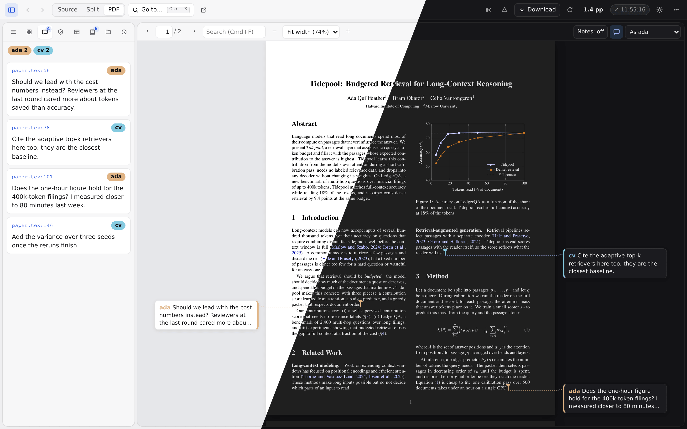

# latex-live

A live LaTeX preview in the browser, in the spirit of LaTeX Workshop and
Overleaf: save a `.tex` file and the PDF rebuilds and reloads in place,
keeping scroll and zoom. It runs where the paper is, on your own machine or a
remote Linux machine you reach through VS Code Remote-SSH, and serves every
preview on one port. It is built on `latexmk -pvc`, SyncTeX and PDF.js, builds
in a TeX Live 2024 image close to Overleaf's, and needs no editor extension and
nothing beyond Python's standard library.



## Features

- Rebuild on save, with errors as a clickable banner, in VS Code's Problems panel, and marked in
  the browser editor, with the build log under it. A
  warm standby has read the preamble already, so a save waits only for the body.
- SyncTeX both ways: double-click the PDF to open the source line, and a key
  in VS Code highlights the current line in the PDF.
- Notes: a notes-free view with each note in a margin bubble, and notes
  written, replied to, resolved and edited from the viewer.
- An editor in the browser, beside the PDF or alone (the PDF in a window of its own, for a second
  screen), that merges with changes saved elsewhere: tabs, folding, completion of labels, citations
  and figures, search across files, a Files tab (new files, figure uploads, renames), and a Cmd/Ctrl+K palette.
  Light and dark themes.
- A bibliography panel: citation counts, one-click `\cite`, and adding entries by arXiv ID, DOI or BibTeX.
- Change highlights against the last push, commit or build, latexdiff against any commit, and a
  History tab of commits with their diffs, to restore a file from.
- A page-limit badge, space hints, and pre-submission checks: anonymity,
  references, fonts, figure placement, what the arXiv source would expose, and more.
- Downloads: as built, without notes (an exact build), or with the notes in the margin;
  and an arXiv package without comments or notes, checked by building it alone.
- Shared mode: coauthors without a LaTeX setup open one link and read,
  comment or edit, each in their role, with every TeX run confined to a container; editors see
  who else is in the paper, and on which line.

## Quick start

On Linux, with Python 3.9+, latexmk, poppler-utils, git and rootless podman:

```bash
git clone https://github.com/ellisbrown/latex-live ~/.local/share/latex-live
podman pull docker.io/minidocks/texlive:2024-full    # once: 4.6 GB, about 8 GB on disk
cd <paper> && python3 ~/.local/share/latex-live/live.py --no-open
```

Open the `http://localhost:44100/p/...?t=...` URL that it prints (on a remote
machine, forward port 44100 first). [docs/setup.md](docs/setup.md) has the
full steps, for a person or a coding agent: prerequisites (macOS too), the VS
Code task that starts the preview when you open the paper, port forwarding,
and troubleshooting.

## Documentation

- [Setup](docs/setup.md): installing, the VS Code tasks, ports and the token,
  options and environment variables, updating, keeping the TeX image, and
  [troubleshooting](docs/setup.md#troubleshooting).
- [The viewer](docs/viewer.md): the layout, the bars and ⋯ menus, notes and the
  notes-free view, the source pane, change highlights and comparing, downloads
  and the review copy, the sidebar, page limits and checks, and keyboard
  shortcuts.
- [Agent plugins](docs/agent-plugins.md): polishing a selection with a model of
  your choice, and how to write the plugin (or have your coding agent write it).
- [Shared mode](docs/shared-mode.md): roles and what each sees, setting it up
  behind a reverse proxy or with personal links, the security model, and
  running it as a service.
- [Contributing](CONTRIBUTING.md): the workflow, how the pieces fit together,
  and the rules for changing latex-live.

## Status

latex-live is at 0.x (see `VERSION`): no stability promise yet. Releases are
tagged `v<VERSION>`; track `main` to follow development. It is used on Linux;
macOS with MacTeX should work but has not been tried. Known limits:

- Notes are the paper's note macros that go through `\todotxt`.
- Page limits are built in for [ten venues](docs/viewer.md#page-limit-and-space);
  pass `--page-limit` for others.
- The token is required even on a laptop, where only localhost reaches the port.

Planned work is in the [issues](https://github.com/ellisbrown/latex-live/issues).

latex-live is under the MIT License (`LICENSE`). PDF.js (Apache-2.0, in
`pdfjs/`) and CodeMirror 6 (MIT, in `codemirror/`) are vendored as published;
see their `LICENSE` and `VERSION` files.
